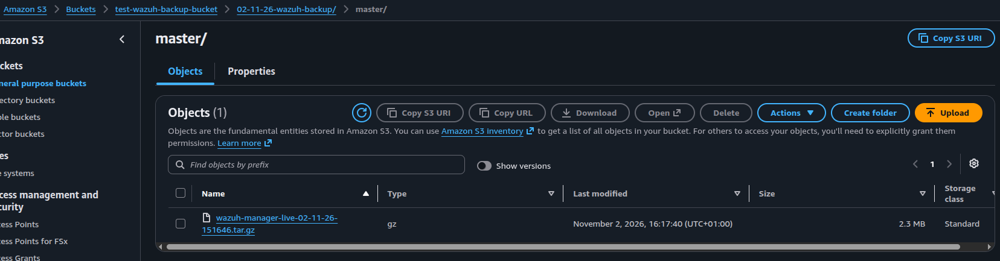

# Production release: 2026-11-02

## Summary

| Field | Details |
| --- | --- |
| Change / ticket |https://github.com/ADORSYS-GIS/wazuh-helm/issues/261, https://github.com/ADORSYS-GIS/wazuh-helm/issues/304, https://github.com/ADORSYS-GIS/wazuh-helm/issues/483|
| Owner |Caleb Asah |
| Target version |chart version `wazuh-helm-1.0.14` |
| Affected services |Wazuh server-side(Wazuh Manager, Indexer, Dashboard) |
| Reason for change |Implement Azure Integration for Wazuh Monitoring, Add MISP (Malware Information Sharing Platform) Helm Chart, Implement GCP Integration for Wazuh Monitoring|
| Planned window / expected impact |10–15 minutes downtime expected |

## Approval

- **Approver and date:** Yannick/2026-10-30
- **Approval link:** 
  - https://github.com/ADORSYS-GIS/wazuh-helm/pull/271
  - https://github.com/ADORSYS-GIS/wazuh/pull/2257

## Deployment

- **Pipeline / Argo CD run:** https://argocd.wazuh.adorsys.team/applications/
- **Recorded deployment plan**:
  - [x] Confirm approval and deployment window
  - [x] Back up the production cluster
    - 
  - [x] Update Wazuh `targetVersion` in Argo CD and deploy
  - [x] Check cluster health after deployment
  - [x] Run system checks and record any deviations
- **Deviations:** Not recorded

## Validation

- **Recorded validation plan**:
  - [x] Wazuh dashboard is accessible
  - [x] Manager, indexer, and dashboard are healthy
  - [x] No unexpected errors or alerts appear in logs
- **Outcome:** New features work

## Rollback and closeout

- **Rollback trigger and steps:** 
Plan: revert to the last stable deployment and disable the new features if needed; estimated 15–25 minutes.
- **Rollback performed / result:** Not recorded
- **Stakeholders notified:** `#wazuh-team` 
- **Follow-up actions / owners:** Yannick
- **Record closed by / date:** Caleb Asah/2026-11/05