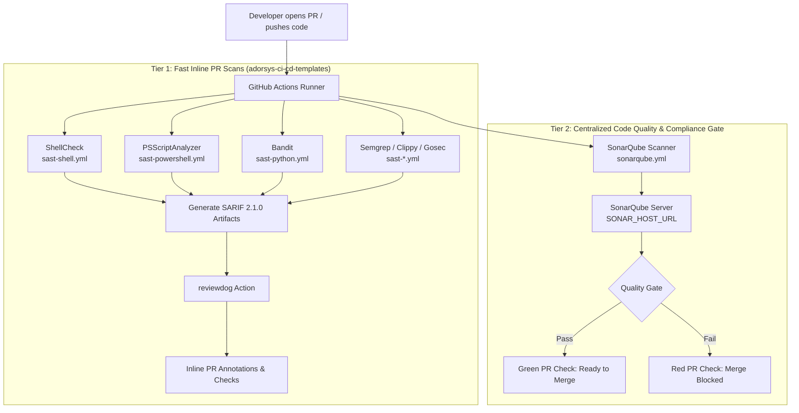

# Static Application Security Testing (SAST) Integration Guide
**Wazuh Ecosystem Central Specification & Compliance Manual**

> **Document Status**: Approved  
> **Classification**: Internal / ISO 27001 Operational Baseline  
> **Target Audience**: SIEM Engineers, Wazuh Contributors, Security Auditors  
> **Source**: Centralized Wazuh Security Operations

---

## 1. What is SAST?

**Static Application Security Testing (SAST)** is a white-box security testing methodology that analyzes source code, bytecode, or configuration files without executing the application.

SAST tools parse the codebase and apply rule engines, semantic pattern matching, and data-flow analyses to detect vulnerabilities early in the software development lifecycle (SDLC). Common classes of defects identified include:

- **Injection Flaws**: SQL, Command, LDAP, and Cross-Site Scripting (XSS).
- **Insecure Deserialization & Path Traversal**.
- **Hardcoded Secrets**: Embedded API tokens, passwords, and private keys.
- **Cryptographic Weaknesses**: Insecure random number generators, deprecated cipher suites, and weak hashing algorithms.
- **Insecure Configurations**: Overly permissive IAM/file permissions, exposed ports, and missing security headers.
- **Dangerous API Misuse**: Unchecked buffer operations, unsafe shell commands, and deprecated library functions.
- **Error Handling & Resource Leaks**: Unhandled exceptions, memory leaks, and unclosed system handles.

### Why SAST Matters
- **Shift-Left Security**: Moves detection to pull request creation, preventing vulnerabilities from reaching build, staging, or production environments.
- **Cost Reduction**: Remediation at the pull request stage costs a fraction of addressing defects after deployment.
- **Comprehensive Coverage**: SAST inspects all code paths across repositories, including edge cases rarely triggered during runtime testing.
- **Actionable Developer Feedback**: Automated PR annotations pinpoint the exact file and line number requiring remediation.
- **Compliance & Audit Readiness**: Provides demonstrable, auditable proof of static analysis required under **ISO 27001**, **OWASP ASVS**, and **PCI DSS**.

### SAST vs. DAST vs. IAST

| Type | Full Name | Methodology | Execution Stage | Ecosystem Scope |
| :--- | :--- | :--- | :--- | :--- |
| **SAST** | Static Application Security Testing | Source code & configuration analysis (White-box) | CI Pipeline (Pull Requests & Pushes) | **Active & Enforced** |
| **DAST** | Dynamic Application Security Testing | Outside-in runtime vulnerability testing (Black-box) | Staging / Deployed Environments | Future Roadmap ([#2185](https://github.com/ADORSYS-GIS/wazuh/issues/2185)) |
| **IAST** | Interactive Application Security Testing | Runtime agent monitoring inside test execution | Integration Testing | Out of Scope |

---

## 2. Overview of the Integration

SAST is integrated across the CI/CD pipelines of the Wazuh ecosystem. Automated scans trigger on every pull request and push to protected branches, validating first-party code before merge.

The integration leverages shared reusable workflows from `ADORSYS-GIS/adorsys-ci-cd-templates@main`. This ensures an identical security standard across all repositories while eliminating duplicated pipeline maintenance.

### Goals
- Automatically detect security weaknesses in first-party code during CI.
- Surface findings inline on GitHub pull requests using Reviewdog for rapid remediation.
- Enforce strict severity gates on protected branches so High and Critical findings block merges.
- Enforce SonarQube as the centralized quality and compliance gate across releases.
- Maintain a single, version-controlled set of reusable workflow templates.

### Non-Goals / Out of Scope
- DAST testing (tracked separately under [#2185](https://github.com/ADORSYS-GIS/wazuh/issues/2185)) and IAST testing (tracked under [#549](https://github.com/ADORSYS-GIS/wazuh/issues/549)).
- Deep scanning of third-party vendor libraries beyond standard dependency checks.
- Replacing peer security reviews (SAST complements human code review).

---

## 3. Architecture

The SAST pipeline operates as a two-tier verification model:



---

## 4. Tools & Scanner Matrix

| Tool | Target Language / Technology | Purpose | Reusable Workflow |
| :--- | :--- | :--- | :--- |
| **SonarQube** | Multi-language | Full-branch static analysis; quality gate enforcement on bugs, vulnerabilities, and compliance standards | `sonarqube.yml` |
| **Checkov** | IaC (Terraform, Helm, Kubernetes) | Misconfigurations, insecure defaults, compliance benchmarks | `sast-iac.yml` |
| **ShellCheck** | Shell (`*.sh`, `*.bash`, `*.zsh`) | Syntax issues, variable quoting, injection risks, portability flaws | `sast-shell.yml` |
| **PSScriptAnalyzer** | PowerShell (`*.ps1`, `*.psm1`) | Windows script security rules, execution vulnerabilities | `sast-powershell.yml` |
| **Bandit** | Python (`*.py`) | Common Python security flaws (unsafe yaml, subprocess injection) | `sast-python.yml` |
| **Gosec** | Go (`*.go`) | Go AST security inspection | `sast-go.yml` |
| **Clippy + Semgrep** | Rust (`*.rs`) | Idiomatic Rust lints, memory safety, and semantic security patterns | `sast-rust.yml` |
| **ESLint + Semgrep** | JavaScript / TypeScript | Security plugins (`eslint-plugin-security`), prototype pollution | `sast-javascript-typescript.yml` |
| **Reviewdog** | All SARIF outputs | Converts scanner SARIF 2.1.0 findings into inline GitHub check annotations | Shared Action |

### SonarQube: The Primary Quality Gate
SonarQube acts as the centralized code-quality and compliance authority. It performs full-branch analysis (evaluating whole branch state, not just diffs) and enforces three gate conditions:
1. **Zero Unresolved Bugs or Vulnerabilities** (at any severity level).
2. **Zero Blockers, Criticals, or Major Issues** (including architectural code smells).
3. **Compliance Standard Alignment**: Evaluates findings mapped against standard frameworks:
   - **OWASP Top 10** (2021)
   - **CWE Top 25** (2024)
   - **PCI DSS 4.0**
   - **OWASP ASVS 4.0**
   - **STIG ASD V5R3 / CASA**

---

## 5. How It Works

1. A pull request or push to a protected branch triggers the SAST workflow.
2. Individual language scanners execute in parallel, emitting standardized **SARIF 2.1.0** reports.
3. **Reviewdog** parses the SARIF files and posts GitHub Check annotations on changed files (`-reporter=github-pr-check` on PRs, `-reporter=github-check` on pushes).
4. **SonarQube** executes full-branch analysis, evaluating overall maintainability, security hotspots, and quality gates.
5. On protected branches (`develop`, `main`), High/Critical findings fail the pipeline and block merges. On feature branches, findings remain advisory to allow work-in-progress iteration.

### Example Caller Workflow (`.github/workflows/sast.yml`)

```yaml
name: Static Application Security Testing (SAST)

on:
  pull_request:
    branches: [main, develop]
  push:
    branches: [main, develop]
  workflow_dispatch:

jobs:
  sast-shell:
    uses: ADORSYS-GIS/adorsys-ci-cd-templates/.github/workflows/sast-shell.yml@main
    with:
      runner: ubuntu-latest
      working-directory: "."
    permissions:
      contents: read
      actions: read
      checks: write

  sast-powershell:
    uses: ADORSYS-GIS/adorsys-ci-cd-templates/.github/workflows/sast-powershell.yml@main
    with:
      runner: ubuntu-latest
      working-directory: "."
    permissions:
      contents: read
      actions: read
      checks: write

  sast-python:
    uses: ADORSYS-GIS/adorsys-ci-cd-templates/.github/workflows/sast-python.yml@main
    with:
      runner: ubuntu-latest
      working-directory: "."
      python-version: "3.12"
    permissions:
      contents: read
      actions: read
      checks: write
```

### Example SonarQube Workflow (`.github/workflows/sonarqube.yml`)

```yaml
name: SonarQube

on:
  push:
    branches: [develop, main]
  workflow_dispatch:

permissions:
  contents: read

jobs:
  scan:
    uses: ADORSYS-GIS/adorsys-ci-cd-templates/.github/workflows/sonarqube.yml@main
    with:
      project-key: wazuh-agent
      runner: arc-runner-set
    secrets:
      SONAR_HOST_URL: ${{ secrets.SONAR_HOST_URL }}
      SONAR_TOKEN: ${{ secrets.SONAR_TOKEN }}
```

---

## 6. Gating Policy

| Branch Context | Gating Behavior | Rationale |
| :--- | :--- | :--- |
| **Feature Branches** (`feat/*`, `fix/*`) | **Advisory**: Scans report inline Reviewdog annotations without failing the build. | Allows developers to iterate and review findings without blocking ongoing work. |
| **Protected Branches** (`develop`, `main`) | **Enforced**: High and Critical findings fail the build (`exit code 1`). | Guarantees that vulnerable code cannot enter production releases. |
| **SonarQube Quality Gate** | **Enforced**: Fails on unresolved bugs, vulnerabilities, or Blockers/Criticals. | Provides auditable quality gate verification for releases. |
| **Scanner Execution Failure** | **Hard Fail**: A crashing or misconfigured scanner fails the step. | Prevents silent false-positive greens if scanning fails to run. |

---

## 7. Repositories Integrated

The following 10 core Wazuh ecosystem repositories have integrated the standardized SAST workflows:

| Repository | Integration PR | Primary Scanners Enforced |
| :--- | :---: | :--- |
| **`wazuh-agent`** | [#259](https://github.com/ADORSYS-GIS/wazuh-agent/pull/259) | ShellCheck, PSScriptAnalyzer, Bandit, SonarQube |
| **`wazuh-agent-installer`** | [#28](https://github.com/ADORSYS-GIS/wazuh-agent-installer/pull/28) | Clippy, Semgrep, SonarQube |
| **`wazuh-agent-status`** | [#248](https://github.com/ADORSYS-GIS/wazuh-agent-status/pull/248) | Clippy, Semgrep, SonarQube |
| **`wazuh-cert-oauth2`** | [#348](https://github.com/ADORSYS-GIS/wazuh-cert-oauth2/pull/348) | Clippy, Trivy, SonarQube |
| **`wazuh-helm`** | [#456](https://github.com/ADORSYS-GIS/wazuh-helm/pull/456) | Checkov, ShellCheck, SonarQube |
| **`wazuh-plugins`** | [#16](https://github.com/ADORSYS-GIS/wazuh-plugins/pull/16) | Bandit, ShellCheck, SonarQube |
| **`wazuh-suricata`** | [#50](https://github.com/ADORSYS-GIS/wazuh-suricata/pull/50) | ShellCheck, BATS/kcov Coverage, SonarQube |
| **`wazuh-yara`** | [#96](https://github.com/ADORSYS-GIS/wazuh-yara/pull/96) | ShellCheck, SonarQube |
| **`wazuh`** | [#2167](https://github.com/ADORSYS-GIS/wazuh/pull/2167) | Checkov, ShellCheck, SonarQube |
| **`global-gateway`** | [#12](https://github.com/ADORSYS-GIS/global-gateway/pull/12) | Checkov, Ansible Lint, SonarQube |

---

## 8. SonarQube Setup & Configuration

- **Repository Secrets Required**:
  - `SONAR_HOST_URL`: Base URL of the SonarQube server (managed securely via repository secrets).
  - `SONAR_TOKEN`: Dedicated project analysis token.
- **Workflow Parameters**:
  - `project-key`: Passed directly to the reusable workflow (`with: project-key: <repository-name>`), matching the registered project in SonarQube.
- **Analysis Scope & Exclusions**:
  - Full-branch analysis runs on every push to protected branches (`sonar.branch.name`).
  - Detailed scan exclusion rules and per-repository configurations are documented in the [SonarQube Scan Exclusions Guide](sonarqube-scan-exclusions.md).
- **Quality Gate Polling**:
  - The CI workflow polls the SonarQube Quality Gate API (with configurable 300s timeout and automatic retry on transient network failures).

---

## 9. Onboarding SAST to a New Repository

To onboard an additional repository into the Wazuh SAST ecosystem:

1. **Add Caller Workflow**: Create `.github/workflows/sast.yml` referencing the language templates matching the repository stack.
2. **Add SonarQube Workflow**: Create `.github/workflows/sonarqube.yml` and register `SONAR_HOST_URL` and `SONAR_TOKEN` in GitHub Secrets.
3. **Register Project**: Ensure the project key exists on the centralized SonarQube server.
4. **Grant CI Permissions**: Ensure the GitHub Actions workflow contains `permissions: { contents: read, checks: write }` for Reviewdog annotations.
5. **Add Local ADR**: Add an Architecture Decision Record in `docs/adr/` following the [canonical ADR template](https://github.com/ADORSYS-GIS/wazuh/blob/main/docs/adr/template.md) and [writing guide](https://github.com/ADORSYS-GIS/wazuh/blob/main/docs/adr/GUIDE.md) in `ADORSYS-GIS/wazuh`, capturing the pre-merge enforcement policy (e.g. `ADR-0001: Pre-Merge SAST Enforcement`).
6. **Reference Central Guide**: Link `README.md` to this master guide in `wazuh-playbook`.

---

## 10. References & Related Documentation

- **SonarQube Scan Exclusions Guide**: [`sonarqube-scan-exclusions.md`](sonarqube-scan-exclusions.md)
- **Reusable CI Templates**: [`ADORSYS-GIS/adorsys-ci-cd-templates`](https://github.com/ADORSYS-GIS/adorsys-ci-cd-templates)
- **Master Epics / Tracking**: [ADORSYS-GIS/wazuh#549](https://github.com/ADORSYS-GIS/wazuh/issues/549) (SAST Integration) / [ADORSYS-GIS/wazuh#2185](https://github.com/ADORSYS-GIS/wazuh/issues/2185) (DAST Roadmap) / [ADORSYS-GIS/wazuh#2190](https://github.com/ADORSYS-GIS/wazuh/issues/2190) (SonarQube Code Coverage)
- **SonarQube Server**: Configured securely across repositories via the `SONAR_HOST_URL` repository secret.
